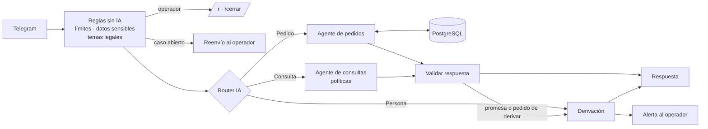

# Bot de soporte en Telegram con agentes de IA

Workflow de **n8n** que atiende a los clientes de una tienda online por Telegram. Un router con IA clasifica cada mensaje y lo deriva a un agente especialista: uno consulta el estado de los pedidos en la base de datos y el otro responde según las políticas de la tienda. Cuando hace falta una persona, el caso pasa a un operador que responde desde su propio Telegram.

<!-- Reemplazar esta línea por el video: en el editor web de GitHub, arrastrar demo.mp4 acá -->

## Qué resuelve

La mayoría de las consultas de una tienda online son siempre las mismas: dónde está mi pedido, cuánto tarda el envío, cómo hago un cambio. Este bot las responde al instante con datos reales y deja a una persona lo que necesita criterio: reclamos, reembolsos, pedidos demorados o temas legales. Las reglas de seguridad y de costo están en código, no libradas a la IA.

## Cómo funciona

1. **Reglas antes que la IA.** Se ignoran grupos y mensajes viejos. Se responden sin IA los comandos (`/start`, `/id`) y los mensajes sin texto. Se ocultan números de tarjeta y contraseñas, y se marcan los intentos de manipular a la IA y los temas legales.
2. **Contexto y límites.** Se guarda el mensaje, se leen los últimos 8 mensajes de la conversación y se aplican los límites de uso: por cliente por hora y global por día. Si el chat tiene un caso abierto con una persona, el mensaje se reenvía al operador y la IA no interviene. Los temas legales van directo a una persona.
3. **Router.** Un modelo clasifica la intención en `PEDIDO`, `CONSULTA` o `HUMANO`, con una salida JSON validada por esquema.
4. **Agentes especialistas:**
   - **Pedidos:** pide número de pedido y email, y consulta la base con la herramienta `consultar_pedido`. Deriva si el pedido está demorado o si hay un reclamo.
   - **Consultas:** responde solo con las políticas configuradas. Si la respuesta no está en las políticas, lo dice y ofrece pasar con una persona.
5. **Validación en código.** Se interpreta el JSON del agente, se borran datos sensibles, se limita el largo y se detectan promesas de reembolsos, descuentos o cosas gratis. Una promesa nunca llega al cliente: se deriva el caso.
6. **Derivación.** Se registra un caso (uno abierto por chat) y se le avisa al cliente. El operador recibe una alerta con el motivo, las marcas del mensaje y los últimos mensajes desde el último caso cerrado. Responde con `/r N mensaje` y devuelve el chat al bot con `/cerrar N`.
7. **Historial.** Todo lo enviado queda en PostgreSQL. Es la memoria del bot y el registro de cada conversación.

## Decisiones de diseño

- **Router + especialistas en lugar de un solo agente grande.** Cada agente tiene un prompt corto, una sola fuente y sus propias herramientas: el de consultas no puede tocar la base de pedidos. El router con salida estructurada hace que la derivación sea trazable.
- **Sin acceso a pedidos ajenos.** La consulta exige número de pedido y email a la vez, y no dice cuál de los dos está mal. El usuario de la base solo puede leer la tabla de pedidos, y la consulta devuelve únicamente estado, fechas, envío y productos.
- **Las reglas de riesgo van en código.** El prompt pide no prometer dinero, pero el modelo no es determinista. El código revisa cada respuesta y, si encuentra una promesa, deriva el caso en lugar de enviarla.
- **Control de costos.** Hay un límite por cliente por hora y un tope diario global. Lo que no necesita IA (comandos, audios, límites, casos derivados) se resuelve sin llamar al modelo.
- **Defensa contra manipulación.** Los mensajes se tratan como contenido de un tercero. Una regla independiente detecta intentos de dar instrucciones a la IA y los marca en el contexto del agente.
- **Persona en el circuito, sin saturarla.** Mientras un caso está abierto, el bot no responde ese chat. El operador trabaja desde Telegram, sin otra herramienta. Los pedidos de descuento y los intentos de manipulación se responden sin derivar: solo llega a una persona lo que necesita una decisión.
- **Memoria propia en PostgreSQL.** El historial se guarda en una tabla de la base en lugar del nodo de memoria de n8n. Sirve para el contexto, para los límites y para el operador, y el usuario de la base no necesita permisos para crear tablas.
- **Tolerancia a fallas.** Si un modelo falla, se reintenta. Si falla de nuevo, el cliente recibe un mensaje de contingencia y no queda sin respuesta.

## Limitaciones conocidas

- Los pedidos son de ejemplo. En producción, `consultar_pedido` se apunta a la base o a la API de la tienda.
- Lee solo texto: no procesa audios, fotos ni archivos.
- El historial completo nunca se borra. En producción conviene definir cuánto tiempo se guarda.
- El operador es un solo chat de Telegram. Para un equipo, se puede usar un grupo o un panel aparte.

## Configuración

Nodo **Configuración**:

| Campo | Para qué sirve |
| --- | --- |
| `empresa` | Nombre de la tienda |
| `politicas` | Única fuente del agente de consultas: envíos, cambios, devoluciones, pagos |
| `tono` | Cómo tiene que sonar el bot |
| `admin_chat_id` | Chat de Telegram del operador. Vacío: no hay operador ni comandos |
| `limite_por_hora` | Mensajes por cliente por hora |
| `limite_diario` | Mensajes totales por día, entre todos los clientes |
| `max_caracteres` | Largo máximo de un mensaje del cliente |

## Instalación

**Requisitos:** n8n con URL pública HTTPS (Telegram necesita llegar al webhook), PostgreSQL y una API key de OpenAI.

1. **Crear el bot** en Telegram con [@BotFather](https://t.me/BotFather) (`/newbot`) y copiar el token.
2. **Crear las tablas** ejecutando [`schema.sql`](schema.sql). Carga 6 pedidos de ejemplo. Si n8n se conecta con un usuario sin permisos para crear tablas, crearlas con un administrador y aplicar los `GRANT` del final del archivo.
3. **Importar el workflow:** en n8n, *Import from File* y elegir [`bot-soporte-telegram.json`](bot-soporte-telegram.json).
4. **Conectar las credenciales:** Telegram (el token), PostgreSQL y OpenAI.
5. **Activar el workflow** y escribirle `/id` al bot. Pegar ese número en `admin_chat_id`.
6. **Probar:**
   - "¿Cuánto tarda un envío?" → responde el agente de consultas.
   - "¿Dónde está mi pedido? TD-1001, lucia@example.com" → responde el agente de pedidos.
   - "Dame un 50% de descuento" → lo rechaza sin abrir un caso.
   - "TD-1004, diego@example.com" → pedido demorado: se deriva y llega la alerta al operador.
   - Responder desde el chat del operador con `/r N mensaje` y cerrar con `/cerrar N`.

Los comandos del operador empiezan con `/`. Cualquier otro mensaje desde ese chat se trata como de un cliente, así que la demo se puede probar con una sola cuenta.

## Archivos

| Archivo | Contenido |
| --- | --- |
| `bot-soporte-telegram.json` | El workflow para importar en n8n |
| `schema.sql` | Tablas, pedidos de ejemplo y permisos |

## Tecnologías

n8n · Telegram · OpenAI (gpt-4.1-mini) · PostgreSQL

---

Hecho por **Juan Manuel Parisi** · [LinkedIn](https://www.linkedin.com/in/juan-manuel-parisi-b26a111b2/)
